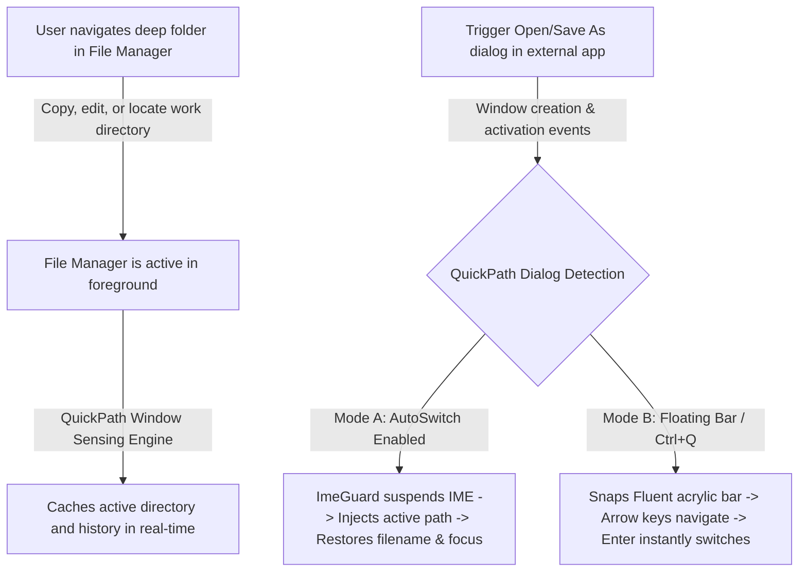

# QuickPath User Manual & Technical Guide

<div align="center">

[使用说明书 (中文)](User_Manual_CN.md) | **English Manual** · [Back to Home](../README.md)

[](#)
[](https://microsoft.com)
[](https://qp.yftec.top)
[](../LICENSE)

**A Modern Fluent-Style Smart Path Following and Quick Navigation Companion for Windows File Dialogs**

[🌐 Official Website](https://qp.yftec.top) · [🐙 GitHub Repository](https://github.com/clhome/QuickPath) · [💬 Submit Issues](https://github.com/clhome/QuickPath/issues)

</div>

---

## Table of Contents

- [1. Product Overview & Working Principles](#1-product-overview--working-principles)
- [2. System Requirements & Runtime Environment](#2-system-requirements--runtime-environment)
- [3. Installation & Startup Modes](#3-installation--startup-modes)
- [4. Core Features & Operation Guide](#4-core-features--operation-guide)
  - [4.1 Smart AutoSwitch](#41-smart-autoswitch)
  - [4.2 Modern Fluent Floating Bar](#42-modern-fluent-floating-bar)
  - [4.3 IME Guard & Filename Preservation](#43-ime-guard--filename-preservation)
  - [4.4 File Manager Ecosystem Integration](#44-file-manager-ecosystem-integration)
  - [4.5 Taskbar Hardware Status Monitor (New in Ver 1.1.0)](#45-taskbar-hardware-status-monitor-new-in-ver-110)
  - [4.6 File Explorer Tab Utility Module (New in Ver 1.2.0)](#46-file-explorer-tab-utility-module-new-in-ver-120)
    - [4.6.1 Module Positioning & Native Lightweight Architecture](#461-module-positioning--native-lightweight-architecture)
    - [4.6.2 Auto Window-to-Tab Capture & Consolidation](#462-auto-window-to-tab-capture--consolidation)
    - [4.6.3 External App "Show in Folder" Takeover with Selection Preservation](#463-external-app-show-in-folder-takeover-with-selection-preservation)
    - [4.6.4 Win + E Smart Interception & Single-Window Experience](#464-win--e-smart-interception--single-window-experience)
    - [4.6.5 Smart Tab Deduplication](#465-smart-tab-deduplication)
    - [4.6.6 Double-Click Tab to Duplicate](#466-double-click-tab-to-duplicate)
    - [4.6.7 Shortcut Reference & Efficiency Guidelines](#467-shortcut-reference--efficiency-guidelines)
- [5. Graphical Settings Center Guide](#5-graphical-settings-center-guide)
  - [5.1 Opening the Settings Center](#51-opening-the-settings-center)
  - [5.2 Configuration Options in Detail](#52-configuration-options-in-detail)
  - [5.3 Settings Draft & Apply Mechanism](#53-settings-draft--apply-mechanism)
- [6. Configuration File & Advanced Customization](#6-configuration-file--advanced-customization)
  - [6.1 Schema & Field Reference](#61-schema--field-reference)
  - [6.2 Process Blacklist Strategy](#62-process-blacklist-strategy)
  - [6.3 Custom External Language Packs](#63-custom-external-language-packs)
- [7. Troubleshooting & FAQ](#7-troubleshooting--faq)
- [8. Producer & License](#8-producer--license)

---

## 1. Product Overview & Working Principles

### 1.1 The Everyday Friction
In typical desktop workflows, power users (developers, designers, video editors, and office workers) constantly switch between **file managers (such as Windows Explorer or Directory Opus)** and **file dialogs ("Open" / "Save As")** in various productivity applications.

Common pain points include:
1. Navigating deep into a complex project folder in your file manager, only to open a file dialog in an IDE or editor that defaults back to "Downloads" or "Documents";
2. Having to manually expand long directory tree hierarchies or copy the folder path from Explorer's address bar and paste it into the dialog;
3. Using outdated scripting utilities that trigger Input Method Editor (IME) candidate popups during paste operations, causing typographical errors or wiping out previously typed filenames.

### 1.2 The QuickPath Solution
**QuickPath** eliminates this disconnect completely. Leveraging native WinEvent hooks and precision Win32 control identification, it provides a sub-100ms path synchronization pipeline:



---

## 2. System Requirements & Runtime Environment

| Specification | Requirement / Details |
| :--- | :--- |
| **Operating System** | Windows 10 (Build 1809 or later) / Windows 11 (All versions, full multi-tab support) |
| **Architecture** | x86_64 (64-bit) |
| **Runtime Dependencies** | Built purely with native Rust; **Zero external runtime dependencies** (No .NET, VC++ Redistributable, or Python required) |
| **Binary Footprint** | Approximately **1.2 MB** (includes embedded high-DPI branding assets and bilingual packages) |
| **System Resource Usage** | Background RAM footprint **< 10 MB** (Incremental RAM footprint $\le 5\text{ MB}$ when Taskbar Monitor is active), Idle CPU utilization **0%** (Worker thread sampling incremental CPU $\le 0.05\%$; when disabled, worker thread and handles are fully terminated, yielding absolute 0% CPU & 0 MB overhead) |
| **Multi-Monitor & DPI** | Full Per-Monitor V2 DPI Awareness; perfectly scales across 100%, 125%, 150%, 175%, and 200% displays |

---

## 3. Installation & Startup Modes

### 3.1 Portable Zero-Install Usage
QuickPath is distributed as a completely portable, standalone single-file binary:
1. Extract `quickpath.exe` to any folder of your choice (e.g., `D:\Tools\QuickPath\` or a USB flash drive);
2. Double-click `quickpath.exe` to run it silently in the background;
3. Once running, the QuickPath logo appears in the Windows system notification tray area (near the clock).

### 3.2 Dual Configuration Storage Modes
- **Portable Mode**: If `quickpath.json` is located in the same directory as the executable, QuickPath stores all user preferences and history locally in that file;
- **Standard Mode**: If no local JSON file is present, preferences are safely stored in `%APPDATA%\QuickPath\config.json`.

### 3.3 UAC-Free Silent AutoStart
- QuickPath features built-in **Windows Task Scheduler** registration for automatic startup;
- This allows QuickPath to launch with highest privileges on system boot **without displaying annoying yellow UAC elevation prompts**;
- Elevated execution ensures seamless inter-process communication with other software running as administrator (e.g., Visual Studio, Elevated Terminals, IDA Pro).

---

## 4. Core Features & Operation Guide

### 4.1 Smart AutoSwitch
- **Description**:
  When transitioning from a supported file manager to an application triggering an "Open" or "Save As" dialog, QuickPath recognizes the contextual relationship and instantly switches the dialog directory to match your active folder.
- **Tuning & Response Delay**:
  - AutoSwitch can be toggled on/off in the Settings Center;
  - **Switch Delay (ms)**: Default is `80ms`. For legacy applications with slower internal UI initialization, consider setting this to `120ms` ~ `150ms`; for rapid switching, `60ms` ~ `80ms` is optimal.
- **Safety & Anti-Overwrite Protection**:
  If you have already started browsing or modifying the directory within the dialog, QuickPath will not re-inject or overwrite your active navigation.

### 4.2 Modern Fluent Floating Bar
- **Visual Design**:
  Employs native Windows 11 Mica and Acrylic blur with smooth rounded corners and adjustable opacity (40% to 100%).
- **Snapping & Positioning**:
  - When a file dialog appears, the bar snaps smoothly to its border (adapting to left, right, or top edges according to screen real estate);
  - Default Summon Hotkey: **`Ctrl + Q`** (fully customizable in settings).
- **High-Density Single-Line Candidate Layout**:
  Candidates are presented in a clean, compact single-line layout:
  ```
  📁 [Folder Name]      D:\Work\Projects\QuickPath      [Source Badge: Active / History / Pinned]
  ```
  Displays up to 8 recent and relevant candidates.
- **Pure Keyboard Blind Navigation**:
  - `↑` / `↓`: Move selection through candidate folders;
  - `Enter`: Confirm selection and inject the directory into the dialog;
  - `Esc`: Dismiss the floating bar;
  - Top header features the producer attribution with a direct clickable link to the official website.

### 4.3 IME Guard & Filename Preservation (ImeGuard)
- **Input Method Editor Guard (ImeGuard)**:
  When communicating with Win32 edit and address bar controls, QuickPath suspends the active thread's IME candidate window for microseconds and restores it immediately upon injection. This prevents Chinese, Japanese, or third-party IMEs from producing pinyin letter sequences or corrupted characters;
- **Write order for WPS owner-drawn dialogs (matches the implementation)**:
  For WPS-style Qt owner-drawn dialogs that expose no native Win32 control handles, QuickPath writes the path through UIA `SetValue` **first — without touching the system clipboard at all**. Only when that write cannot be verified does it fall back to a transactional clipboard injection that restores the clipboard atomically. Either way, `Enter` is sent only after a successful read-back;
- **Intelligent Filename Preservation**:
  In "Save As" scenarios where you have already typed a custom filename (e.g., `Financial_Report_Q4.xlsx`), QuickPath isolates the filename, synchronizes only the target directory, and **never clears or overwrites your filename**.

### 4.4 File Manager Ecosystem Integration

| File Manager | Integration Principle & Details |
| :--- | :--- |
| **Windows 11 File Explorer** | Native **Multi-Tab** recognition. Overcomes legacy COM limitations to pinpoint the currently focused tab |
| **Windows 10 File Explorer** | Full support for standard single-window `CabinetWClass` enumeration |
| **Directory Opus (DOpus)** | Bridges via `dopusrt` command-line IPC to retrieve active Lister paths in milliseconds |
| **Total Commander (TC)** | **Experimental and off by default.** Its path can only be returned through the system clipboard, so QuickPath never probes it in the background. Enable it in Settings → Managers, then use **“Get path from TC” in the tray menu or floating bar** to fetch the path once, on demand. Each probe snapshots the clipboard first, and cancels itself (**without restoring an old snapshot over your current clipboard**) whenever the source cannot be proven — e.g. a concurrent copy, a missing update event or an unknown owner. Note that the target manager may still write its path after the request, so avoid copying anything important while a probe is running |
| **XYplorer** | **Experimental and off by default**, same rules as Total Commander: authorize in Settings → Managers, then trigger “Get path from XYplorer” manually |

### 4.5 Taskbar Hardware Status Monitor (New in Ver 1.1.0)

#### 4.5.1 Module Positioning & Unprivileged Lightweight Design
Integrated as QuickPath's **built-in optional extension module** (enabled by default, fully toggleable in settings or the system tray menu), providing desktop users with a minimalistic, zero-overhead, highly reliable native Windows taskbar hardware dashboard:
- **Unprivileged Official APIs**: Operates purely within standard user-mode Windows APIs (IP Helper API `GetIfTable2`, `GetSystemTimes`, `GlobalMemoryStatusEx`, PDH Performance Counters, DXGI `IDXGIAdapter3`), eliminating any Ring 0 kernel driver dependencies or system crash vulnerabilities;
- **Extreme Lightweight & Zero Idle Waste**: Consumes $\le 5\text{ MB}$ additional working set RAM when active ($\le 0.05\%$ incremental CPU); **when disabled, the background worker sampling thread and all system query handles are completely released, dropping to absolute 0% CPU and 0 MB incremental footprint**.

#### 4.5.2 Compact Two-Row Layout & ClearType Crisp Rendering
Features a high-density, two-row compact grid layout (height dynamically conforms to the 32~40px taskbar, with width smoothly self-adjusting from ~40px to ~130px depending on selected metrics):

```text
┌───────────────────────────────────────────┐
│  ↑  1.2     C: 19%    G: 32%              │  <- Row 1: Upload Mbps (Hidden Unit)   | CPU% (Mini Bar) | GPU%
│  ↓  3.5     M: 42%    D:  3%              │  <- Row 2: Download Mbps (Hidden Unit) | RAM% (Mini Bar) | Disk Activity
└───────────────────────────────────────────┘
```

- **Streamlined Unit-Free Network Display**: Bitrates are normalized to `Mbps` with text unit labels omitted (retaining only directional arrow prefixes `↑` and `↓`). Values $< 100$ maintain 1 decimal place, while values $\ge 100$ display as integers, saving nearly 40% taskbar width;
- **Dynamic Column Shrink Engine**: Metrics are grouped into 3 logical columns (Network, CPU/RAM, GPU/Disk). Unselected columns collapse completely without occupying any pixels, ensuring zero unnecessary whitespace;
- **Mini Indicator Bars & 3-Tier Dynamic Threshold Coloring**: CPU and RAM values feature a 2px dynamic gauge bar below numbers. All CMGD metrics (CPU, Memory, GPU, Disk) dynamically tint based on utilization: `< 70%` Vivid Green, `70% ~ 85%` Bright Yellow, `> 85%` Warning Red;
- **Solid Dark Background & Win32 ClearType Rendering**: Renders via `Microsoft YaHei UI` with native ClearType smoothing and smooth alpha protection, preventing wallpaper bleeding and ragged edges;
- **Real-Time Historical Waveform Graph Background**: Displays an optional 15~20 second rolling waveform polyline behind metric text (1000ms sampling ring buffer) to instantly visualize short-term spikes;
- **Three Sampling Refresh Rates**: Choose between 1.0s, 3.0s (recommended default), and 5.0s.

#### 4.5.3 Dual Dock Position Modes
Freely switch docking location via Settings or the right-click menu:
1. **Right of Taskbar (TrayLeft, Default)**: Neatly docks directly adjacent to the left edge of the system notification tray area;
2. **Above Taskbar Left Float (TaskbarLeft)**: Floats independently directly above the upper edge of the taskbar on the left side, physically separating from running application taskbar buttons to eliminate overlap.

#### 4.5.4 Full-Screen Auto-Hide (Game & Media Stealth Evasion)
Specially engineered to protect immersive experiences during gaming and presentations:
- Continuously monitors foreground windows. When a full-screen application is detected (e.g., 3D games, full-screen video, PowerPoint slide shows covering the primary display), the monitor window invokes `ShowWindow(SW_HIDE)` silently;
- Instantly and smoothly reappears upon returning to the desktop or normal windowed workflows;
- Fully synchronized with the Windows Taskbar "Auto-Hide" mode.

#### 4.5.5 Fluent Hardware Dashboard (Tooltip)
Hovering over the docked monitor bar for 400ms reveals a modern Fluent dark card dashboard with high-contrast `Microsoft YaHei UI` typography and auto-scaled dimensions:
- **Network Bitrate & Adapter**: Displays dual units (both Mbps and MB/s) along with the active physical network adapter name (accurately filtering loopback, virtual adapters, Docker, WSL, VMware, and VPNs);
- **Processor (CPU)**: Reports total utilization and highlights the **Top 1 resource consumer process name and percentage**;
- **Physical Memory (RAM)**: Shows percentage and exact allocation (e.g., `Used 13.4 GB / Total 32.0 GB`);
- **Dedicated Graphics (GPU)**: Shows composite 3D/Compute utilization and **Dedicated VRAM** allocation (e.g., `3.8 GB / 8.0 GB`, strictly filtering out inflated shared system memory);
- **Disk I/O**: Real-time read and write throughput in MB/s;
- **Continuous System Uptime**: Accurate boot uptime calculated via `GetTickCount64`, unaffected by Windows Fast Startup;
- **Power & Battery**: Reports AC power connection or current battery percentage;
- **Producer Attribution**: Displays producer branding with a clickable link to the official website, supporting seamless mouse cursor transit between the docked bar and the dashboard.

#### 4.5.6 Mouse & Shortcut Controls
- **Double-Click**: Quickly launches Windows Task Manager (`taskmgr.exe`) via `ShellExecuteW`;
- **Right-Click**: Opens native context menu with quick controls:
  - `Open QuickPath Settings...` (navigates directly to Taskbar Monitor tab)
  - `Show Metrics` (independently toggle Network, CPU, RAM, GPU, Disk)
  - `Show Historical Waveform` (toggle waveform background)
  - `Dock Position` (toggle Right of Taskbar / Above Taskbar Left Float)
  - `Refresh Network Adapters` (re-enumerates active interfaces)
  - `Hide Monitor Panel` (dismisses panel)
  - `Exit QuickPath`
- **System Tray Integration**: Toggle taskbar monitoring on/off at any time from the tray icon's context menu.

### 4.6 File Explorer Tab Utility Module (New in Ver 1.2.0)

#### 4.6.1 Module Positioning & Native Lightweight Architecture
In Windows 11 (22H2 Build 22621 and later), Microsoft officially introduced native multi-tab functionality into File Explorer (implemented via XAML island `ShellTabWindowClass`). However, several frustrating user experience gaps remain in the default Windows behavior:
1. **Proliferation of Redundant Windows**: Pressing `Win + E` or clicking "Show in Folder" from external applications (IDEs, browsers, chat tools) persistently spawns new top-level independent windows, quickly cluttering your desktop;
2. **Tab Clutter & Infinite Duplication**: Opening the same folder multiple times spawns duplicate tabs without intelligent reuse;
3. **Lack of Instant Tab Cloning**: Power users lacking an effortless mouse gesture to duplicate a tab side-by-side for folder comparison.

QuickPath **Ver 1.2.0** deconstructs this workflow and provides a pure Rust native **File Explorer Tab Utility**:
- **Pure Native & Zero External Dependencies**: Built strictly upon Win32 APIs, Shell COM interfaces (`IShellWindows` / `IShellBrowser` / `IShellView`), and UI Automation. **Zero external DLL injection**, ensuring total immunity from antivirus heuristic false alarms;
- **Extreme Memory & CPU Efficiency**: Bypasses heavy rendering engines completely; consumes only **5MB ~ 10MB** incremental working set memory with **0.00%** idle CPU;
- **Clean Lifecycle**: When disabled in Settings, all global system hooks are completely unhooked and released, reverting Windows to 100% native behavior.

#### 4.6.2 Auto Window-to-Tab Capture & Consolidation
- **Dual-Event Complementary Interception**: Simultaneously registers `EVENT_OBJECT_CREATE` and `EVENT_OBJECT_SHOW` via `SetWinEventHook`. This ensures 100% reliable detection of incoming `CabinetWClass` windows, resolving edge cases during cold start initialization;
- **Off-Screen Layered Concealment (Zero Flash)**: In the microsecond an incoming Explorer window spawns, QuickPath applies `WS_EX_LAYERED` with Alpha=0 and shifts its coordinates off-screen. This preserves COM initialization while completely eliminating the unsightly white/black screen flashes common in legacy tools;
- **Windows 11 Native Magic Command `0xA21B`**: Sends internal command `WM_COMMAND (0xA21B)` directly to the destination window's `ShellTabWindowClass`, creating an instant tab natively, backed by robust UI Automation and keyboard fallbacks;
- **Safe Destruction & Focus Transition**: Once the target tab is attached and directed to the target directory, the temporary source window is smoothly closed and destroyed, leaving focus naturally inside the new tab.

#### 4.6.3 External App "Show in Folder" Takeover with Selection Preservation
Development and productivity software (such as VS Code, Cursor, IntelliJ IDEA, Google Chrome, WeChat, and Telegram) frequently invokes `explorer.exe /select,"C:\path\to\file.ext"` or the Shell API `SHOpenFolderAndSelectItems` to reveal files to users.
- **Metadata Penetration Extraction**: QuickPath asynchronously queries the incoming window's `IShellItem` and `IShellView` COM interfaces to determine the exact parent folder path and the specific target filename to be selected;
- **Intelligent Tab Consolidation**: If an Explorer window is already open, the action is routed into that window (switching to an existing tab if already open, or creating a new tab directed to the parent folder);
- **100% Selection Fidelity (Crucial)**: Once the directory view finishes loading, QuickPath dispatches `IShellView::SelectItem` with `SVSI_SELECT | SVSI_ENSUREVISIBLE | SVSI_FOCUSED`. **The target file remains vividly highlighted and scrolled into the center of the view**, solving the long-standing flaw in basic window mergers where files lose their selected state.

#### 4.6.4 Win + E Smart Interception & Single-Window Experience
- **No Existing Explorer Window**: When you press the global shortcut `Win + E`, QuickPath lets the system proceed natively, launching the initial primary window;
- **Existing Explorer Window Present**: Intercepts the redundant top-level window and converts the action into creating a new tab in the active Explorer window (defaulting to Home or This PC), preserving an orderly single-window desktop environment.

#### 4.6.5 Smart Tab Deduplication
- When navigating to folders, QuickPath extracts canonical normalized physical paths across all open tabs in the host window;
- If the folder is already open in an existing tab, focus shifts immediately to that tab, stopping identical folders from proliferating across the tab bar;
- **Intent-Aware Bypass**: Deduplication applies to external navigations and address jumps. It automatically bypasses when the user intentionally triggers the "Double-Click Tab to Duplicate" gesture described below.

#### 4.6.6 Double-Click Tab to Duplicate
- **Intuitive Mouse Gesture**: **Double-click any tab** on the File Explorer tab bar using the left mouse button, and QuickPath will instantly clone and open an identical folder tab directly to its right;
- **Ideal for Multi-Directory Workflows**: Compare files or drag items between adjacent views without tedious path copying or manually pressing `+`;
- **Low-Level Precision Hit-Testing**: Combines a low-level mouse hook with UI Automation hierarchy resolution to accurately identify the clicked `TabItem` node even when the tab is currently in the background.

#### 4.6.7 Shortcut Reference & Efficiency Guidelines

| Action / Shortcut | Description |
| :--- | :--- |
| **`Win + E`** | When Tab Utility is active, opens a new tab in the existing window instead of launching a separate window *(New in Ver 1.2.0)* |
| **Double-Click Tab** | Double-click any tab on the Explorer tab bar to clone the same folder to its right *(New in Ver 1.2.0)* |
| **Middle-Click Tab** | Middle-click any tab to close it quickly *(Windows Native Feature)* |
| **`Ctrl + Tab`** | Cycle forward smoothly through adjacent tabs *(Windows Native Feature)* |
| **`Ctrl + Shift + Tab`** | Cycle backward smoothly through adjacent tabs *(Windows Native Feature)* |
| **`Ctrl + T`** | Create a new default home tab in the active window *(Windows Native Feature)* |
| **`Ctrl + W` / `Ctrl + F4`** | Close the currently active tab *(Windows Native Feature)* |

---

## 5. Graphical Settings Center Guide

### 5.1 Opening the Settings Center
- **Mouse Action**: **Single-click** or **Double-click** the QuickPath icon in the system notification tray;
- **Context Menu**: **Right-click** the tray icon and select **"⚙️ Settings"**.

### 5.2 Configuration Options in Detail

The Settings Center utilizes a modern Fluent **four-tab** card layout (freely toggle between "General Preferences", "Tab Utility", "Taskbar Monitor" and "Managers" at the top):

#### "General Preferences" Tab
1. **Smart AutoSwitch**
   - **Toggle Switch**: Click or drag the toggle switch horizontally to enable or disable automatic path following;
   - **Response Delay**: Fine-tune the millisecond delay slider to balance responsiveness and stability.
2. **Floating Bar Appearance**
   - **Custom Opacity Slider**: Smoothly adjust transparency between **40% and 100%**;
   - Real-time visual feedback updates the acrylic blur density dynamically.
3. **Global Hotkey**
   - Displays the currently assigned shortcut badge (e.g., `Ctrl + Q`);
   - **Interactive Recording**: Click the card to enter recording mode ("Press shortcut combination..."). Press any desired key combo (e.g., `Ctrl + Shift + F`, `Alt + D`, `Win + Q`);
   - Press `Esc` to cancel recording without making changes;
   - New shortcuts are re-registered dynamically without restarting the application.
4. **AutoStart on Boot**
   - Toggles Windows Task Scheduler registration for silent, UAC-free execution on startup.
5. **Language Selection**
   - Select between **简体中文 (Simplified Chinese)** and **English** via a native dropdown menu;
   - All interfaces, tray menus, floating bars, and tooltips update immediately.
6. **About QuickPath Card**
   - Features the high-resolution bicubic resampled QuickPath logo;
   - Displays version number, product overview, and producer branding (*Quzhou Yufeng Technology Co., Ltd.*);
   - Includes clickable hyperlinks to the official website ([https://qp.yftec.top](https://qp.yftec.top)) and the GitHub repository ([https://github.com/clhome/QuickPath](https://github.com/clhome/QuickPath)).

#### "Tab Utility" Tab (New in Ver 1.2.0)
1. **Master Toggle Card (Card T0: Enable Tab Utility)**:
   - Standalone top master switch (similar to the Taskbar Monitor toggle). Click or drag to enable or completely disable Explorer multi-tab enhancement;
   - **Master-Child Linked Dimming**: When the master switch is disabled, all sub-cards gracefully dim and disable mouse interactions, while global hooks are completely unhooked from the system.
2. **Shortcuts & Window Integration Group Card (Card T1)**:
   - **Win + E Opens New Tab**: Intercepts the system global `Win + E` shortcut. If an Explorer window is already open, opens a new tab in the active window instead of launching a separate window; if no window exists, lets the system open the initial primary window naturally.
3. **Smart Behaviors & Mouse Gestures Group Card (Card T2)**:
   - **Smart Tab Deduplication**: When navigating to folders, matches canonical paths against all open tabs in the active window. If the folder is already open, switches focus directly to that tab to prevent endless duplication;
   - **Double-Click Tab to Duplicate**: Double-click any tab on the File Explorer tab bar to clone and open the same folder to its right, boosting efficiency when organizing and comparing directories.
4. **High-Efficiency Tips Card (Card T3)**:
   - Permanent guidance card at the bottom illustrating native shortcuts:
     - `• Middle-click any tab to close it quickly`;
     - `• Press Ctrl+Tab or Ctrl+Shift+Tab to cycle smoothly through adjacent folder tabs`.
5. **System Compatibility Fallback Display**:
   - If running on Windows 10 or pre-22H2 Windows 11 builds lacking native XAML Explorer tabs, the Tab Utility section gracefully displays an informational "System Unsupported" banner explaining the OS requirement, while core path following and taskbar monitoring remain 100% operational.

#### "Taskbar Monitor" Tab (New in Ver 1.1.0)


1. **Hardware Monitor Master Switch**: Easily enable or completely disable taskbar hardware monitoring. When turned off, the background worker thread exits immediately with zero resource usage;
2. **Dock Position**: Radio buttons for selecting placement:
   - **Right of Taskbar (Default)**: Docks snugly to the left of the system notification tray;
   - **Above Taskbar Left (Float)**: Floats independently directly above the taskbar's left edge, eliminating any overlap with running taskbar app buttons;
3. **Metric Item Checkboxes**: Five independent toggles to customize visible metrics:
   - Network Throughput (Upload / Download)
   - CPU Utilization
   - Physical Memory (RAM)
   - GPU Utilization
   - Disk Activity (Disk)
   The panel dynamically shrinks or widens based on your selection;
4. **Appearance & Sampling Parameters**:
   - **Show Historical Waveform Graph**: Toggles the 15~20s polyline background trend;
   - **Sampling Refresh Rate**: Fluent capsule segmented control offering `1.0s`, `3.0s (Recommended)`, and `5.0s`;
   - **Panel Opacity Slider**: Custom slider adjusting background opacity between `50%` and `100%`.

#### "Managers" Tab (New in Ver 1.2.3)
1. **Two authorization switches (off by default)**:
   - "Experimental: Total Commander probe" and "Experimental: XYplorer probe";
   - A switch **only grants permission**: turning it on never probes by itself and never touches the system clipboard;
   - Both switches are migrated to `false` once when upgrading from an older version.
2. **How to trigger a single fetch**:
   - **Tray menu**: with the **Total Commander / XYplorer window in the foreground**, right-click the tray icon and choose "📂 Get path from TC" / "📂 Get path from XYplorer". The item is **grayed out** when the foreground window is not that manager;
   - **Floating bar**: after a file dialog appears, the `[TC]` / `[XY]` buttons appear in the bar header. The bar is a `WS_EX_NOACTIVATE` window, so the foreground at click time is always the dialog; those buttons therefore use the "**most recent source bound to the current dialog-open event**" semantics and are **not** a strict foreground trigger. The binding expires as soon as the dialog changes or closes.
3. **Clipboard limits during a probe**:
   - A probe briefly uses the system clipboard (full snapshot → empty → ask the manager to write → restore);
   - **Only one clipboard transaction may run at a time**: explicit probes share a single process-wide exclusive lease with WPS when it falls back to clipboard injection or restores the filename; a conflicting request is rejected outright **without touching the clipboard**. **Both entries are grayed while a clipboard transaction is in flight** (the bar button shows `...`) — note that a WPS injection completing through UIA `SetValue` does not occupy the clipboard and is therefore not grayed;
   - **Only one WPS operation may run at a time as well**: WPS injection and the delayed filename restore share a single operation-level exclusive lease (process-wide), so a repeated trigger is de-duplicated (no double Enter, no wrong-directory navigation). Such conflicts are rejected by the underlying lease and are unrelated to the graying above.
   - WPS injection is likewise single-flight: repeated triggers on the same dialog are de-duplicated (no double Enter, no wrong-directory navigation);
   - Avoid copying anything important until the probe finishes.
4. **Visible result of cancel / timeout / unprovable source**:
   - Path found: injected into the active dialog when one exists, otherwise recorded to history only, plus a tray balloon "Manager path fetched";
   - No path (timeout, unprovable source, lost ownership, no attributable target, failure cooldown): **no old snapshot is restored over your current clipboard**, plus a tray balloon "No path fetched (cancelled or timed out)";
   - Note that the target manager may still write its path after the request, so "QuickPath does not restore an old snapshot" is **not** the same as "a concurrent copy can never be lost".

### 5.3 Settings Draft & Apply Mechanism
- **Draft Protection**: Modifications made inside the settings window remain in draft state until confirmed;
- **Click "OK"**: Commits all changes to disk, hot-reloads global runtime `AppState`, synchronizes the Task Scheduler, and closes the window;
- **Click "Cancel" or Close [X]**: Discards pending changes and restores the previous configuration.

---

## 6. Configuration File & Advanced Customization

### 6.1 Schema & Field Reference
Settings are serialized in standard JSON format:

```json
{
  "auto_switch_enabled": true,
  "auto_switch_delay_ms": 80,
  "hotkey": "Ctrl+Q",
  "floating_bar_enabled": true,
  "floating_bar_auto_show": false,
  "floating_bar_opacity": 90,
  "autostart_enabled": false,
  "autostart_task_scheduler": true,
  "language": "en-US",
  "blacklist_processes": [
    "chrome.exe",
    "msedge.exe",
    "firefox.exe",
    "brave.exe"
  ],
  "pinned_folders": [
    "D:\\Projects",
    "C:\\Users\\Public\\Downloads"
  ],
  "history_folders": [],
  "enable_win11_tabs": true,
  "enable_dopus": true,
  "enable_totalcmd": false,
  "enable_xyplorer": false,
  "tab_module": {
    "enabled": true,
    "wine_to_tab": true,
    "deduplication": true,
    "double_click_to_duplicate": true
  },
  "monitor": {
    "enabled": true,
    "position": "TrayLeft",
    "show_network": true,
    "show_cpu": true,
    "show_memory": true,
    "show_gpu": true,
    "show_disk": true,
    "show_graph_bg": true,
    "refresh_interval_ms": 3000,
    "opacity": 95
  }
}
```

#### Experimental Clipboard-Based Probes (Total Commander / XYplorer)

| Property | Type | Default | Description |
| :--- | :--- | :--- | :--- |
| `enable_totalcmd` | boolean | `false` | Authorizes the Total Commander clipboard-based probe. **Granting permission never triggers a probe by itself**: the path is only fetched when you click “Get path from TC” in the tray menu or the floating bar. The same applies to `enable_xyplorer` |
| `enable_xyplorer` | boolean | `false` | Authorizes the XYplorer clipboard-based probe (same rules as above) |

A probe briefly uses the system clipboard and restores it afterwards. If the source of the update cannot be proven (concurrent copy, missing update notification, unknown owner, timeout), QuickPath cancels the probe and **will not restore an old snapshot over what you currently have on the clipboard**. Note that the target manager may still write its path after the request, so avoid copying anything important while a probe is running. If you upgrade from an older version, both switches are migrated to `false` once.

#### File Explorer Tab Utility Configuration Properties (New in Ver 1.2.0)
| Property | Type | Default | Description |
| :--- | :--- | :--- | :--- |
| `enabled` | boolean | `true` | Master switch for File Explorer multi-tab enhancement (releases all global hooks when false, zero system overhead) |
| `wine_to_tab` | boolean | `true` | Whether to convert global `Win + E` into opening a new tab inside the existing active Explorer window |
| `deduplication` | boolean | `true` | Whether to activate existing open tabs when navigating to already open folder paths |
| `double_click_to_duplicate` | boolean | `true` | Whether double-clicking any tab on the Explorer tab bar duplicates that folder tab to its right |

#### Taskbar Hardware Monitor Configuration Properties (New in Ver 1.1.0)
| Property | Type | Default | Description |
| :--- | :--- | :--- | :--- |
| `enabled` | boolean | `true` | Master switch for taskbar hardware status monitoring (background worker thread terminates completely when false, zero overhead) |
| `position` | string | `"TrayLeft"` | Docking location mode: `"TrayLeft"` (Right of Taskbar default) or `"TaskbarLeft"` (Above Taskbar Left Float) |
| `show_network` | boolean | `true` | Whether to display real-time network throughput (Row 1 upload, Row 2 download) |
| `show_cpu` | boolean | `true` | Whether to display processor utilization (CPU) and mini indicator bar |
| `show_memory` | boolean | `true` | Whether to display physical memory utilization (RAM) and mini indicator bar |
| `show_gpu` | boolean | `true` | Whether to display dedicated graphics utilization (GPU) |
| `show_disk` | boolean | `true` | Whether to display disk I/O activity utilization (Disk) |
| `show_graph_bg` | boolean | `true` | Whether to render the 15~20 second historical waveform polyline background |
| `refresh_interval_ms` | integer | `3000` | Sampling refresh interval in milliseconds (supports 1000 / 3000 / 5000) |
| `opacity` | integer | `95` | Monitor panel background opacity percentage (50 ~ 100) |

### 6.2 Process Blacklist Strategy (`blacklist_processes`)
Certain applications may have specific download behaviors where automatic path switching is undesirable:
- Web browsers (Chrome, Edge, Firefox): Users often prefer saving web downloads to a fixed default folder;
- Add lower-case executable names to the `blacklist_processes` array (e.g., `"notepad.exe"`). QuickPath will bypass AutoSwitch for these processes while still allowing manual summoning via hotkey.

### 6.3 Custom External Language Packs
QuickPath includes embedded English and Simplified Chinese localization, while allowing arbitrary external language extensions:
1. Create a `locales/` directory next to `quickpath.exe`;
2. Add your TOML file (e.g., `locales/ja-JP.toml` or `locales/de-DE.toml`);
3. Translate keys following the structure of `en-US.toml`;
4. Re-open the Settings Center, and the new language will appear in the dropdown menu automatically.

---

## 7. Troubleshooting & FAQ

### Q1: Why doesn't QuickPath switch paths in certain applications?
- **Cause 1 (UIPI Elevation Isolation)**: If the target application was launched as Administrator while QuickPath runs with standard user privileges, Windows User Interface Privilege Isolation (UIPI) blocks cross-privilege communication. **Solution**: Enable "AutoStart" in settings or run QuickPath as Administrator.
- **Cause 2 (Process Blacklist)**: Verify that the process is not listed in `blacklist_processes` inside `config.json`.
- **Cause 3 (Timing)**: Increase the switch response delay in settings from `80ms` to `120ms` ~ `150ms`.

### Q2: Shortcut hotkey fails to register or conflicts?
- If the selected shortcut is already registered by another global application (e.g., chat applications, PowerToys), Windows will reject registration. Choose an alternative combination in settings.

### Q3: How does the floating bar handle multi-monitor or mixed DPI setups?
- QuickPath utilizes real-time DPI queries (`GetDpiForMonitor`) to detect the specific physical display containing the file dialog, recalculating bounds and scale factors dynamically to prevent window clipping.

### Q4: Antivirus false positives?
- QuickPath is built from clean, open-source Rust. Because it utilizes `SetWinEventHook` to monitor window focus and registers global hotkeys, rare heuristics-based antivirus engines might flag it. QuickPath contains zero telemetry, backdoors, or adware; you can safely whitelist it or inspect the source code.

### Q5: Why does the monitor panel disappear during full-screen games, videos, or presentations? *(New in Ver 1.1.0)*
- **Answer**: This is intentional behavior driven by QuickPath's built-in "Full-Screen Stealth Evasion Mechanism". Whenever the foreground window occupies full-screen resolution (e.g., 3D games, video players in full screen, PowerPoint presentations), the monitor panel automatically hides silently to prevent obstructing gameplay visuals or subtitles. It seamlessly restores once you return to windowed mode or the desktop.

### Q6: Why are unit suffixes hidden on the docked network speed display? *(New in Ver 1.1.0)*
- **Answer**: To achieve a high-density, compact layout within precious taskbar real estate, bitrates are calculated uniformly in `Mbps` while text labels are omitted (retaining only `↑` and `↓` arrow prefixes). This saves nearly 40% of taskbar width. To view comprehensive dual units (both MB/s and Mbps) as well as the active physical adapter name, simply hover over the monitor bar to inspect the Hardware Dashboard tooltip.

### Q7: What does Dedicated VRAM represent, and why does it differ from total VRAM shown in some tools? *(New in Ver 1.1.0)*
- **Answer**: QuickPath strictly measures the dedicated graphics card's physical on-board memory (**Dedicated VRAM**, e.g., 4.0 GB physical VRAM) via DXGI and PDH hardware queries. This intentionally filters out the inflated "Shared GPU Memory" pool that Windows dynamically allocates from system RAM, reflecting true hardware video memory pressure.

### Q8: How can I change the docking position of the monitor on the taskbar? *(New in Ver 1.1.0)*
- **Answer**: Right-click the monitor bar and select "Dock Position", or configure it under the "Taskbar Monitor" tab in Settings:
  - **Right of Taskbar (Default)**: Docks snugly to the left of the notification tray icons;
  - **Above Taskbar Left (Float)**: Floats independently directly above the taskbar's left edge, completely preventing any visual overlap with running application taskbar icons.

### Q9: Why does Settings show "File Explorer Tabs Not Supported on Current Windows"? *(New in Ver 1.2.0)*
- **Answer**: The multi-tab enhancement relies on the native XAML tabs architecture introduced in **Windows 11 22H2 (Build 22621 or newer)**. If you are running Windows 10 or an earlier Windows 11 build, your system does not have the native tab infrastructure. QuickPath automatically detects this and gracefully disables the tab module with an informational banner, while all core file dialog AutoSwitch and hardware monitor features continue to work flawlessly.

### Q10: Why does double-clicking a tab duplicate the folder, while opening the same folder from outside triggers deduplication? *(New in Ver 1.2.0)*
- **Answer**: This is powered by QuickPath's "intent-aware routing":
  1. Opening folders via external apps usually signifies navigating to an existing workspace, so smart deduplication switches focus to your existing tab to prevent tab clutter;
  2. In contrast, **explicitly double-clicking a tab** expresses a deliberate desire for a duplicated side-by-side view (e.g., comparing files). QuickPath automatically triggers a deduplication bypass to honor this intent.

### Q11: How does QuickPath preserve file selection when using "Show in Folder" from VS Code, Cursor, etc.? *(New in Ver 1.2.0)*
- **Answer**: Basic tab mergers often navigate to the parent folder without restoring selection state. In the microsecond an incoming window spawns, QuickPath queries `IShellView` and Shell items to extract the exact item to be selected. Once the tab view is mounted in the target window, QuickPath invokes `IShellView::SelectItem` with `SVSI_SELECT | SVSI_ENSUREVISIBLE | SVSI_FOCUSED`, ensuring the file remains vividly highlighted and scrolled into view.

---

## 8. Producer & License

- **Producer**: Quzhou Yufeng Technology Co., Ltd. (衢州御风科技有限公司)
- **Official Website**: [https://qp.yftec.top](https://qp.yftec.top)
- **GitHub Repository**: [https://github.com/clhome/QuickPath](https://github.com/clhome/QuickPath)
- **License**: Released under the [GNU General Public License v3.0 (GPL-3.0)](../LICENSE).
